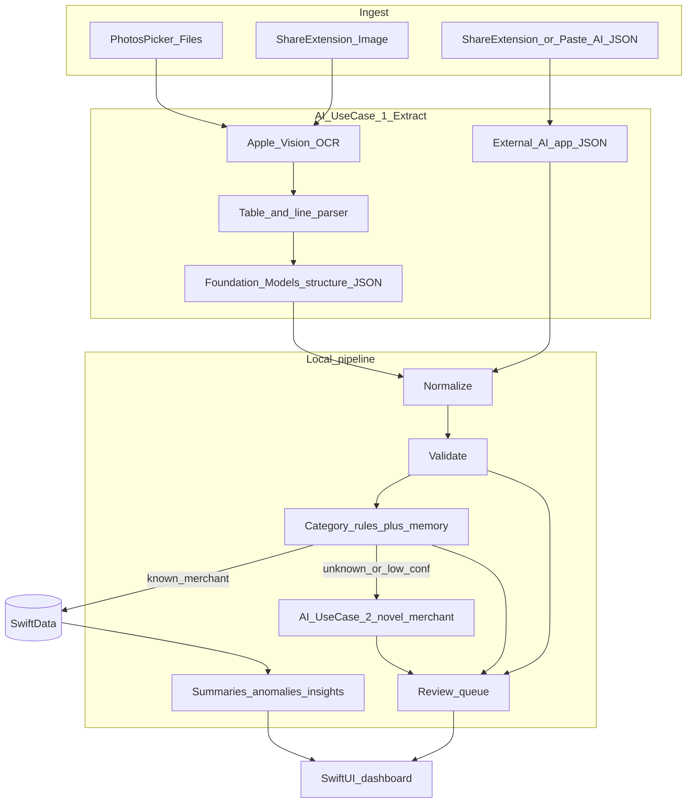

# Design — Local-First iOS (002)

## Architecture

## Tech stack

- Swift 6 / SwiftUI / SwiftData
- PhotosUI `PhotosPicker`
- Share Extension (image + text)
- Vision (`VNRecognizeTextRequest`) for OCR
- Apple Foundation Models (optional, availability-gated)
- Swift Charts
- Domain logic in SPM package `SpendingDomain` (pure Swift, unit-tested)

## Module map

| Module | Responsibility |
| --- | --- |
| `SpendingDomain` | Models (value types), normalize, validate, categorize, summaries, anomalies, insights, extraction schema/prompts, privacy, finance helpers, pipeline orchestration |
| `SpendingAssistant` | SwiftData persistence, Vision OCR bridge, Foundation Models adapters, import UI, dashboard UI |
| `ShareExtension` | Accept shared images and text into the app group inbox |

## AI use case 1 — screenshot processing

1. Persist source image under Application Support `Sources/`.
2. Run Vision OCR → `raw_text` + line boxes.
3. Layout-aware parser combines Vision geometry into merchant/amount pairs and row dates or preceding date headers. Apple Card and Capital One layouts have explicit presets; card names and statement-month context are editable.
4. If incomplete and Foundation Models available: structure OCR text into extraction JSON schema.
5. Else if user provides AI JSON: validate and ingest.
6. Feed candidates through normalize → validate → categorize → persist.

## AI use case 2 — novel merchant categorization

1. Rules + `apply_future` merchant memory first.
2. Unknown / low confidence: on-device classifier prompt → `{category, confidence, reason}`.
3. Still low: ReviewQueue.
4. External paste or manual pick can write a merchant rule.

## Stable IDs

Same strategy as 001-mvp: SHA-256 truncated hash of `sourceDocumentId|rowIndex|date|merchant|amount` (and analogous for assets/reviews/anomalies). Local source IDs replace Drive file IDs.

## Source types

`photos` | `files` | `share` | `ai_import` | `manual`

## Error handling

- Per-file failures mark `SourceDocument.status = error` with masked `error_summary`; other files continue.
- Invalid AI JSON produces a reviewable import error, not a crash.
- Foundation Models unavailable → skip AI path silently and continue with heuristics/rules/review.

## Security / privacy

- No secrets in repo.
- Mask long numbers, emails, and secret-like tokens in logs.
- Configurable source file retention. Cleanup runs on app activation or explicit request. Explicit stored-image deletion preserves local rows, OCR geometry, and deduplication identity; it does not alter the system Photos library.
- App Group only for Share Extension inbox handoff.
- Automatic privacy cover when the app is inactive. Optional Face ID / device passcode lock (disabled by default) requires authentication on launch and return from background; cancellation leaves content covered; import/export processing stays paused until unlocked.
- Temporary export files use complete file protection, unique names, and cleanup after share/cancel and on launch. Shared files contain sensitive records and OCR evidence.

## Relationship to v1

The TypeScript Next.js app under `src/` remains a **reference implementation** for algorithm parity and historical capstone demos. New product work targets `ios/`.

## Manual entry and correction

Home and Import link to a searchable transaction list. Manual input creates a `manual` source, validates fields and duplicate risk, applies category rules or an explicit category, and commits rows/reviews/derived summaries atomically. A source detail can also receive manual rows linked to its original evidence. Corrections preserve transaction identity and original evidence. Only an explicit category change resolves category review.

Optional Foundation Models calls use availability checks on iOS 26+, operate locally on OCR text, and confidence-cap generated extraction/category suggestions for review. They are an enhancement to deterministic layout parsing, not a requirement for the two supported screenshot styles. Failed sources can reparse retained OCR geometry after image deletion; sources with existing rows use manual correction instead of silent re-extraction.

## Dashboard time series and shared editors

Home uses the selected month as the end of recorded history and a currency picker so USD/KRW totals never combine. The spending view applies the category filter to both its totals and its drill-down rows. Cash flow is portfolio-wide within the selected currency; it comes from the same persisted monthly summaries that are rebuilt after import, correction, or deletion. Linear fits use the actual distance between recorded months. Year-over-year comparisons require the matching prior-year month. Asset trends group by account ID, balance type, and currency; related spending attributes only through matching account IDs. Month-over-month prior balances require an immediately preceding month observation; otherwise Home shows previous-observation date and change. Carried-forward balances keep their original dates and are not treated as fresh observations. Linear projections are labelled historical extrapolations without investment-return claims.

Review, Transactions, and Sources open the same transaction editor with account/currency selection. A category change and any field corrections commit together; saving asks whether to add a merchant rule. Open issues stay separate from resolved issue history. Source and balance swipe actions open their respective editors, and destructive actions identify which underlying record will be removed.

## Export, restore, and eligibility

`Eligibility` centralizes local vs desktop rules. Usable unresolved transactions may remain provisional locally; desktop-eligible rows require resolved mandatory issues. Invalid, unmapped, non-finite, conflicting, or pending balances are withheld from valuations and desktop export with reasons preserved. Spending semantics (`SpendingClassification` / `SpendingMath`) define gross spending, refunds, net spending, income, internal transfers, and card settlements in one contract—rent/utilities stay spending; recognized card settlements do not.

Portable backups are versioned envelopes (`PortableBackup`) with dataset/snapshot IDs, completeness, counts, and integrity hashes. Records and OCR evidence export by default; originals are optional and marked included/omitted/expired/missing/unavailable. Imports, edits, and exports share one coordinator lock so a snapshot is consistent. Restore validates the package, stages attachments, commits atomically, and uses a recovery journal if interrupted; failure preserves the prior dataset. Derived summaries are rebuilt after restore. Legacy unversioned JSON can restore with account/currency mapping required afterward; extraction JSON import remains a separate Import path.
