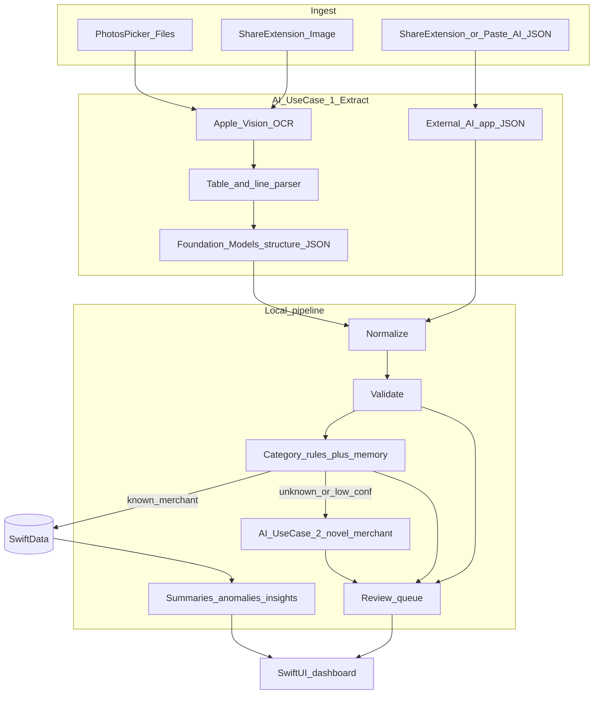

# Design — Local-First iOS (002)

## Architecture

## Tech stack

- Swift 6 / SwiftUI / SwiftData
- PhotosUI `PhotosPicker`
- Share Extension (image + text)
- Vision (`VNRecognizeTextRequest`) for OCR
- Apple Foundation Models (optional, availability-gated)
- Swift Charts
- Domain logic in SPM package `SpendingDomain` (pure Swift, unit-tested)

## Module map

| Module | Responsibility |
| --- | --- |
| `SpendingDomain` | Models (value types), normalize, validate, categorize, summaries, anomalies, insights, extraction schema/prompts, privacy, finance helpers, pipeline orchestration |
| `SpendingAssistant` | SwiftData persistence, Vision OCR bridge, Foundation Models adapters, import UI, dashboard UI |
| `ShareExtension` | Accept shared images and text into the app group inbox |

## AI use case 1 — screenshot processing

1. Persist source image under Application Support `Sources/`.
2. Run Vision OCR → `raw_text` + line boxes.
3. Heuristic line parser looks for date + amount + merchant patterns.
4. If incomplete and Foundation Models available: structure OCR text into extraction JSON schema.
5. Else if user provides AI JSON: validate and ingest.
6. Feed candidates through normalize → validate → categorize → persist.

## AI use case 2 — novel merchant categorization

1. Rules + `apply_future` merchant memory first.
2. Unknown / low confidence: on-device classifier prompt → `{category, confidence, reason}`.
3. Still low: ReviewQueue.
4. External paste or manual pick can write a merchant rule.

## Stable IDs

Same strategy as 001-mvp: SHA-256 truncated hash of `sourceDocumentId|rowIndex|date|merchant|amount` (and analogous for assets/reviews/anomalies). Local source IDs replace Drive file IDs.

## Source types

`photos` | `files` | `share` | `ai_import`

## Error handling

- Per-file failures mark `SourceDocument.status = error` with masked `error_summary`; other files continue.
- Invalid AI JSON produces a reviewable import error, not a crash.
- Foundation Models unavailable → skip AI path silently and continue with heuristics/rules/review.

## Security / privacy

- No secrets in repo.
- Mask long numbers, emails, and secret-like tokens in logs.
- Configurable source image retention days; cleanup on launch and settings change.
- App Group only for Share Extension inbox handoff.

## Relationship to v1

The TypeScript Next.js app under `src/` remains a **reference implementation** for algorithm parity and historical capstone demos. New product work targets `ios/`.
